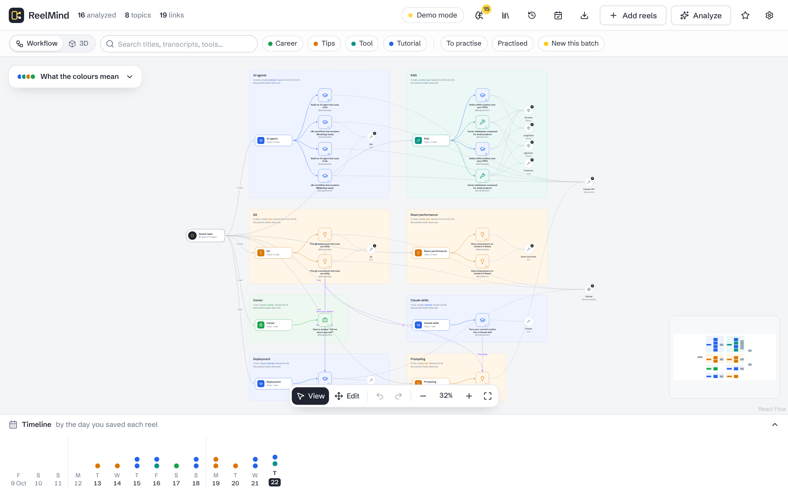
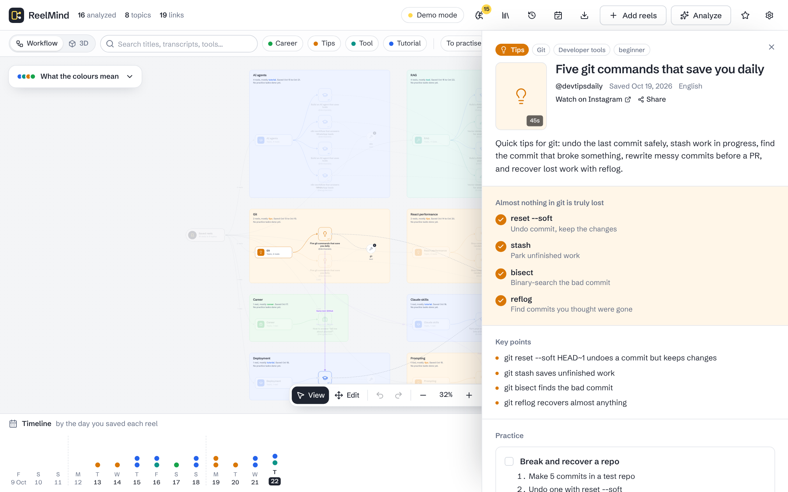
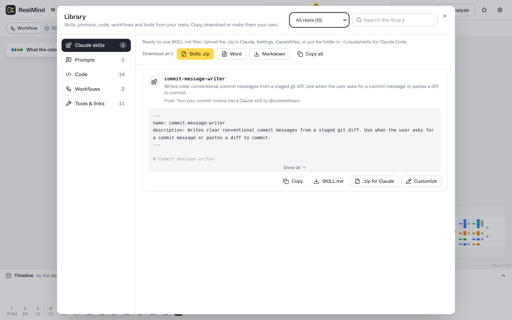
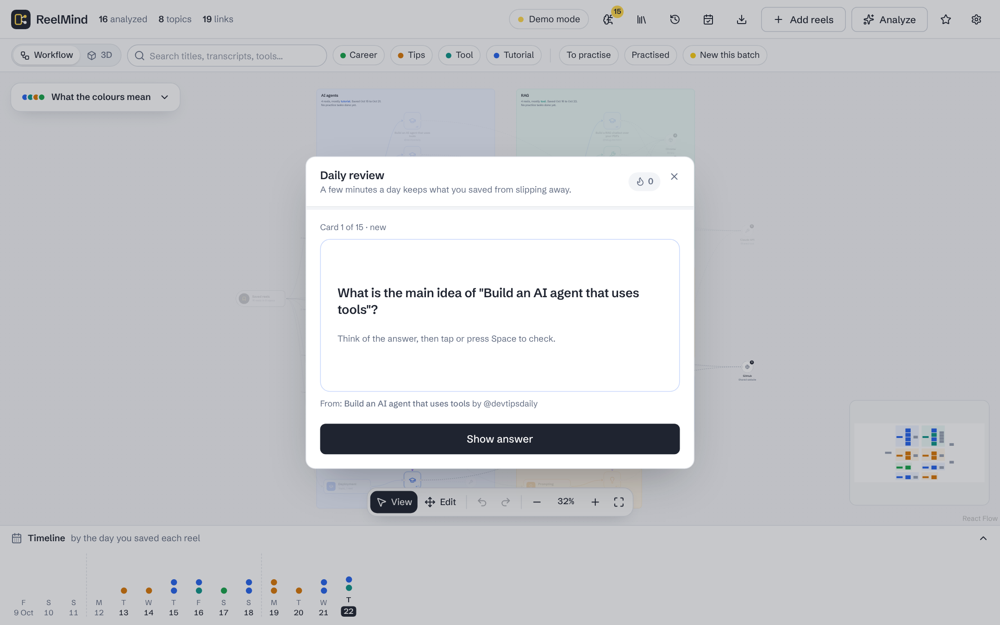

<div align="center">


# ReelMind

**Turn the reels you save on Instagram into study notes you'll actually use.**

Local-first · Free and open source · Bring your own AI key

[Live demo](https://reelmind-tau.vercel.app) · [Quick start](#quick-start) · [Features](#features) · [Contributing](CONTRIBUTING.md) · [Licence](#licence)




</div>

You save 30 technical reels a day and can't recall any of them by the weekend. ReelMind watches each saved reel with AI and lays them all out on a workflow board: one node per topic, wired to its reels, wired to the tools they use.

For every reel you get:
- a summary and key points
- a hands-on practice task
- a one-glance infographic
- the reusable bits it teaches: Claude skills, prompts, code and workflows

On top of that, related reels link to each other, topics merge into learning paths, and spaced-repetition flashcards help it stick.

Your reels, notes and API keys stay on your computer. Nothing is downloaded or analyzed until you click **Analyze**, and no reel is ever analyzed twice.

> **Try it in 10 seconds:** open the [live demo](https://reelmind-tau.vercel.app) and click **Try with 16 sample reels**. No install, no account.

## Contents

- [Screenshots](#screenshots)
- [Features](#features)
- [Quick start](#quick-start)
- [Use it from your phone](#use-it-from-your-phone)
- [Browser extension](#browser-extension)
- [Configuration](#configuration)
- [Deploy your own copy](#deploy-your-own-copy)
- [How it works](#how-it-works)
- [Security and responsible use](#security-and-responsible-use)
- [Development](#development)
- [Contributing](#contributing)
- [Roadmap](#roadmap)
- [Author](#author)
- [Licence](#licence)

## Screenshots

| Reel notes | Library |
| --- | --- |
|  |  |
| **Daily review** | **Workflow board** |
|  |  |

## Features

### Bring in your reels
- **Import formats:**
  - Instagram's data export: the whole ZIP, `saved_posts.json`, `saved_collections.json` or the HTML version
  - pasted reel links
  - collection names are kept
- **Never pay twice:**
  - Each reel is identified by its Instagram shortcode.
  - Re-uploading a file, pasting a link in another format or clearing your browser never re-analyzes a reel.
  - The helper keeps its own cache too.
- **You decide what runs.** Adding reels is free. You choose which ones to analyze, for example only those saved in the last 7 days.
- **Resumable batches.** If you close the tab, hit a rate limit or cancel, finished reels are kept and the rest stay queued.
- **From your phone.** Install ReelMind as an app and share reels straight from the Instagram app (see [below](#use-it-from-your-phone)).
- **Browser extension.** A side panel for sending reels while you browse Instagram, one at a time or a whole Saved page at once.

### See how it all connects
- **Workflow board**, laid out like an automation editor: Saved reels → topics → reels → tools. Each topic sits on its own note.
- **Links by meaning:**
  - Reels that cover the same idea are joined even across topics, with the reason shown ("Same tool: Claude API", "Similar idea").
  - A tool used in several topics becomes one shared node.
- **View and Edit modes, like Figma:**
  - View mode only pans and zooms, so nothing moves by accident.
  - Press **Edit** (or V) to drag reels, topics or whole topic notes.
  - Undo and redo with Ctrl+Z and Ctrl+Shift+Z. Your layout is saved, and **Reset** puts everything back.
- **Exploring the board:**
  - Hover a reel for its cover, summary and creator.
  - Click any node to focus it; everything unconnected fades back.
  - Search and filter across titles, transcripts, tools and creators.
  - A timeline shows which day you saved what.
- **3D view.** Rotate and zoom your whole collection as a knowledge graph.

### Learn it, don't just save it
- **Reel notes:**
  - summary, infographic and key points
  - a practice task with code to copy and a done checkbox
  - tools and links, connected reels, transcript
- **Topic boards.** Merge the reels of any topic into:
  - an overview and a step-by-step learning path
  - a comparison table, with where the reels agree and disagree
  - one project that uses all of them
- **Daily review:**
  - Every reel becomes 3–5 flashcards, scheduled with spaced repetition.
  - Grade each card Again, Hard, Good or Easy (keys 1–4).
  - Keep a daily streak.
- **Weekly recap and quiz:** what you saved, what's left to practise, and a quiz that brings back older reels too.
- **History.** Every AI result (boards, recaps, rewrites, flashcards) is kept, compressed, in your browser. Reopen, copy or restore earlier versions.

### Library: skills, prompts, code, workflows, tools
- **What's collected:**
  - a ready-to-use **Claude skill** (`SKILL.md`) when a reel teaches one
  - prompts written out in full
  - code and commands
  - step-by-step workflows
  - every tool with its link
- **Each item:**
  - **Copy** it.
  - **Download** it as `SKILL.md`, a `.zip` for Claude or a code file.
  - **Customize** it yourself, or tell the AI what to change. The original is always kept.
- **Each category:** download everything as Word, Markdown, a `.zip`, or a CSV of tools.

### Take your notes anywhere
- **Export formats:**
  - a PNG or JPG of the board
  - a print-ready PDF study guide
  - Word
  - Excel
  - Markdown for Obsidian or Notion
- **Summaries** of any length, from one line to full notes. No AI call needed.
- **Share cards** sized for Instagram, LinkedIn or WhatsApp.
- **Read-only share links.** The notes travel inside the link itself; nothing is uploaded.
- **Backup and restore** of the whole workspace as one file.
- **Optional sync** across devices with your own Firebase project.

**Colour means something:**
- blue for tutorials
- teal for tools
- amber for quick tips
- coral for news
- violet for opinions
- green for career
- yellow always means new

### Which AI does what

| | Gemini (default) | Claude (optional) |
| --- | --- | --- |
| Cost | Free tier available | Your own API key, billed per use |
| Analyzing a reel | Watches the video and hears the speech | Reads still frames and the caption |
| Topic boards, recaps | Yes | Yes |
| Links by meaning | Yes (embeddings) | Uses Gemini for this when a Gemini key is set |

## Quick start

ReelMind has two parts:
- **Web app:** runs in your browser. You can use the hosted one or your own.
- **Helper:** a small program on your computer that downloads reels and calls the AI.

You need a free [Gemini API key](https://aistudio.google.com/apikey).

### Windows: double-click install

1. Download this repository (**Code → Download ZIP**) and unzip it.
2. Double-click **`Install-ReelMind.cmd`**. It:
   - installs Node.js, yt-dlp, ffmpeg and cloudflared with `winget`
   - asks for your Gemini key (up to 5 keys)
   - creates a **ReelMind** desktop shortcut, and optionally starts ReelMind with Windows
   - opens the app
3. From then on, use the shortcut or **`Start-ReelMind.cmd`**. **`Update-ReelMind.cmd`** gets the latest version.

### macOS, Linux or manual setup

Install [Node.js 22+](https://nodejs.org), [yt-dlp](https://github.com/yt-dlp/yt-dlp#installation) and [ffmpeg](https://ffmpeg.org) (recommended). Then:

```bash
git clone https://github.com/sisi-tarak/reelmind.git
cd reelmind
npm install
npm run helper
```

The first run asks for your Gemini key and saves it to `helper/.env`. The helper then prints a link like this:

```
Hosted app:    https://reelmind-tau.vercel.app/#connect=<your code>
Connect code:  <your code>
```

Open the link and the app is connected. Keep the helper running while you use ReelMind.

**Prefer everything local?** Run `npm start`. It builds the app and serves it at http://localhost:5317, with no hosted site involved.

**Browsers:** Chrome, Edge, Brave and Firefox can reach the helper from the hosted site. Chrome may ask once to allow access to devices on your local network; choose Allow. If your browser blocks it (some Safari versions do), use `npm start`.

### Get your saved reels out of Instagram

1. Instagram → **Settings** → **Accounts Center** → **Your information and permissions** → **Download your information**.
2. Choose **Some of your information**, tick **Saved**, then **Download to device** in **JSON** format.
3. When the email arrives, drop the ZIP into ReelMind.

You can also paste reel links directly, or send them from the extension or your phone.

### If downloads ask for a login

Instagram often wants a login before it serves a video. Sign in to Instagram in your browser, then add this to `helper/.env`:

```
YTDLP_COOKIES_BROWSER=chrome
```

yt-dlp reuses that browser's sign-in. ReelMind never sees or stores your password.

## Use it from your phone

1. Turn on [sync](#optional-sync-across-devices) and sign in on your computer and your phone.
2. Install the app on your phone:
   - **Android:** open the site in Chrome → menu → **Install app**. In Instagram, tap **Share** → **ReelMind**.
   - **iPhone:** add the site to your Home Screen from Safari, then create the "Send to ReelMind" Shortcut. The steps are in the app under Settings → Use on your phone.
3. Shared reels wait on the phone as "Waiting for computer". Your computer analyzes them as soon as its helper runs.

**Analyze immediately while you're out (optional).** Add `REELMIND_TUNNEL=on` to `helper/.env` and restart the helper.
- The helper opens a secure [Cloudflare tunnel](https://developers.cloudflare.com/cloudflare-one/connections/connect-networks/downloads/) and the app shows a QR code to scan.
- Every request through the tunnel needs your connect code.
- For a fixed address, use [Tailscale Serve](https://tailscale.com/kb/1312/serve) and set `REELMIND_PUBLIC_URL`.

## Browser extension

A Chrome/Edge side panel that stays open while you browse Instagram:
- Send or analyze the reel you're watching.
- Collect many reels (even a whole Saved page) and send them together.

To install it, load the `extension/` folder unpacked. See [extension/README.md](extension/README.md).

## Configuration

All helper settings live in `helper/.env`; see [`helper/.env.example`](helper/.env.example). The most useful ones:

| Setting | What it does |
| --- | --- |
| `GEMINI_API_KEY` … `GEMINI_API_KEY_5` | Up to 5 Gemini keys. Calls rotate across them, and when one hits its daily limit the next takes over. Create each key in a **different Google Cloud project**, because keys in one project share a quota. |
| `ANTHROPIC_API_KEY` | Optional Claude key for re-analysis and writing. |
| `GEMINI_RPM` | Calls per minute, to stay under your rate limit. |
| `YTDLP_COOKIES_BROWSER` | Reuse your browser's Instagram sign-in for downloads. |
| `REELMIND_TUNNEL` / `REELMIND_PUBLIC_URL` | Phone access while you're away. |
| `REELMIND_APP_URL` | Your own deployment's address, so the helper prints the right link. |
| `REELMIND_DATA_DIR` | Where downloads and analyses are cached (default `./data`). |

**Costs:** Gemini's free tier is enough for personal use, but it has per-minute and daily [limits](https://ai.google.dev/gemini-api/docs/rate-limits). If the daily limit is hit, the batch pauses and the rest waits until tomorrow. On the free tier Google may use prompts to improve its products; use a paid key if that matters to you.

### Where your data lives

| Data | Location |
| --- | --- |
| Library, notes, boards, review progress | This browser's IndexedDB |
| Copy for your other devices (only if sync is on) | Your own Firebase project, under `users/<your id>/`, readable only by you |
| Downloaded reels, transcripts, analyses | `./data/reels/<shortcode>/` |
| Topic boards and recaps | `./data/cache/` |
| Connect code | `./data/connect-code.txt` |

## Deploy your own copy

The web app is a static site.

- **Vercel:** **Add New → Project**, import your fork, keep the root directory, and deploy. `vercel.json` sets up the build, security headers and routing.
- **Any static host:** run `npm run build` and publish `web/dist`.

Then set `REELMIND_APP_URL` in `helper/.env` to your site's address. If you want your own share links, also set `VITE_PUBLIC_URL` when building.

### Optional: sync across devices

Sync uses Firebase's free tier (Google sign-in plus Firestore). Without these settings, the sync section doesn't appear.

1. In the [Firebase console](https://console.firebase.google.com), create a project and add a **Web app**.
2. **Authentication:**
   - Under **Sign-in method**, enable **Google**.
   - Under **Settings → Authorized domains**, add your site's domain.
3. **Firestore Database:** create a database, then paste [`firestore.rules`](firestore.rules) into **Rules** and publish.
4. Set the environment variables, then redeploy:
   - `VITE_FIREBASE_API_KEY`
   - `VITE_FIREBASE_AUTH_DOMAIN`
   - `VITE_FIREBASE_PROJECT_ID`
   - `VITE_FIREBASE_APP_ID`

   For local builds, put them in `web/.env.local` (see `web/.env.example`).

## How it works

```
Instagram export ─► Web app (your browser) ──────────► Helper (your computer)
                    parses links, dedupes,               yt-dlp downloads each reel
                    stores everything in IndexedDB       Gemini or Claude writes the notes
                    draws the board                      results cached in ./data
```

- **Web app** (`web/`): React 19, Vite, TypeScript, Tailwind CSS, shadcn/ui, React Flow, Dexie (IndexedDB).
- **Helper** (`helper/`): Node + Express on `localhost:5317`. It downloads with yt-dlp, calls the AI, paces requests, and caches every download and analysis.
- **Extension** (`extension/`): a Manifest V3 side panel.

## Security and responsible use

**Your keys and data stay with you:**
- The helper listens only on your computer.
- Pages on `localhost` can use the helper. The hosted site needs the **connect code** the helper prints, so no other website can reach your keys or spend your credits.
- API keys live only in `helper/.env` and never reach the browser.

**Things to keep private:**
- Never commit `.env` files. They're in `.gitignore`.
- Treat `cookies.txt` (if you use one) like a password.
- Treat your connect code like a password too. If you think it leaked, delete `data/connect-code.txt` and restart the helper to get a new one.

**Use it responsibly:**
- ReelMind is for personal study of reels **you** saved.
- Downloading content from Instagram may be against [Instagram's Terms of Use](https://help.instagram.com/581066165581870). Run the helper only for your own account, on your own computer.
- Don't redistribute downloaded videos, and respect creators' work. Your notes are for your own learning.
- The hosted site never fetches, hosts or stores anyone's videos.

**Found a vulnerability?** Please report it privately as described in [SECURITY.md](SECURITY.md), not in a public issue.

## Development

```bash
npm install
npm run dev:demo    # demo helper (no keys, no downloads) + app at http://localhost:5173
npm run dev         # real helper + app
npm test            # web and helper tests
npm run typecheck   # TypeScript checks for the web app
npm run sample      # rebuild the bundled sample reels
```

```
reelmind/
  web/                   React app
    src/lib/             parsing, storage, links, layout, export, sync, helper client
    src/features/        board, import, queue, panels, library, review, settings
    src/components/ui/   shadcn/ui components
  helper/                local Node helper
    src/fetcher.js       yt-dlp download with caption-only fallback
    src/ai.js            Gemini and Claude calls, key rotation, pacing, embeddings
    src/analyzer.js      reel analysis
    src/boards.js        topic boards and weekly recaps
    src/flashcards.js    flashcards for older reels
    src/assets.js        skills, prompts and code; AI rewrites
    src/tunnel.js        optional phone access
    src/server.js        API and connect-code checks
  extension/             browser extension (load unpacked)
  scripts/               Windows installer, sample builder
  docs/screenshots/      images used in this README
  firestore.rules        security rules for optional sync
  examples/              a sample export for trying the app
```

## Contributing

Contributions are welcome: bug reports, ideas, docs, translations and code. Read [CONTRIBUTING.md](CONTRIBUTING.md) to get set up, and please be kind in issues and reviews.

Good first contributions:
- Improve the import parser for new Instagram export formats.
- Add tests for the board layout and link scoring.
- Translate the interface.
- Package the extension for the Chrome Web Store.

## Roadmap

- Extension on the Chrome Web Store
- More AI providers (local models via Ollama)
- Interface translations
- Import from YouTube Shorts and TikTok saves

Have an idea? [Open a feature request](https://github.com/sisi-tarak/reelmind/issues/new/choose).

## Author

Built by **Sisindri** ([@sisi-tarak](https://github.com/sisi-tarak)), founder of **[Webortex](https://webortex.com)**.

If ReelMind helps you, please ⭐ [star the repository](https://github.com/sisi-tarak/reelmind) or [sponsor the work](https://github.com/sponsors/sisi-tarak). Want an AI tool like this for your business? [Webortex builds them](https://webortex.com).

## Licence

[GNU AGPL-3.0](LICENSE).
- You may use, study, change and self-host ReelMind freely, including commercially.
- If you distribute a modified version, or run one as a service that other people use, you must publish your source code under the same licence.

The board is built with [React Flow](https://reactflow.dev). Downloads use [yt-dlp](https://github.com/yt-dlp/yt-dlp).
